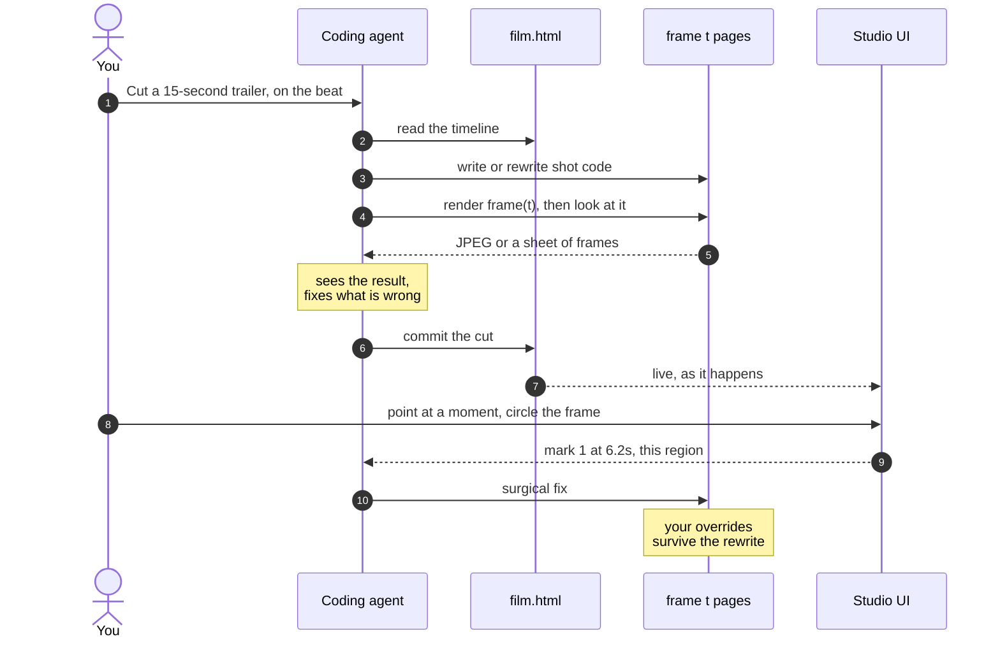
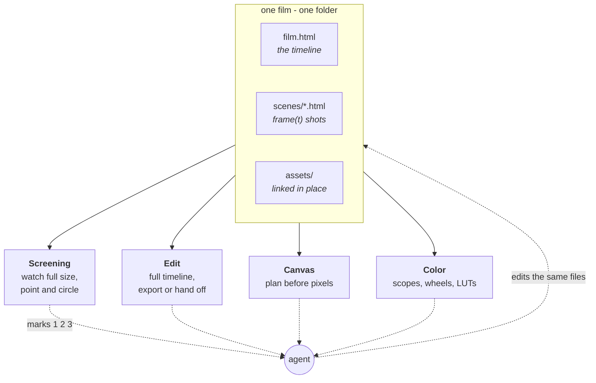
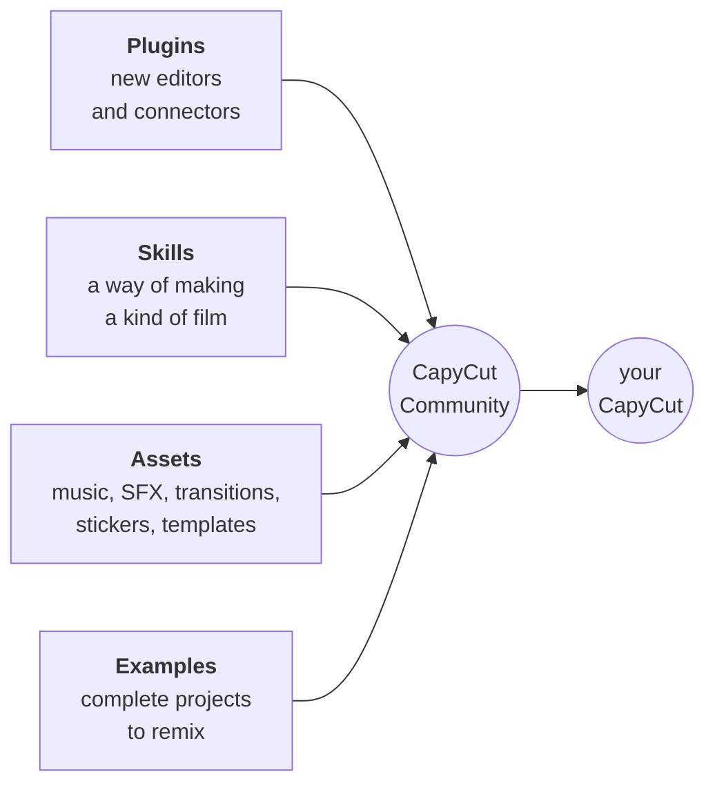

<p align="center">
  <picture>
    <source media="(prefers-color-scheme: dark)" srcset="docs/logo-dark.svg">
    <source media="(prefers-color-scheme: light)" srcset="docs/logo-light.svg">
    
  </picture>
</p>

<h3 align="center">The open source AI video agent.</h3>

<p align="center">
  <em>A film is a folder. A shot is a web page. Your coding agent is the editor.</em><br>
  <em>Built for <strong>Teens Hack Houston 2026</strong> — "a more efficient way to live."</em>
</p>

<p align="center">
  <a href="#install"></a>
  <a href="#how-it-works"></a>
  <a href="#editors"></a>
  <a href="docs/RESEARCH.md"></a>
</p>

<p align="center">
  <a href="#install"></a>
  <a href="docs/RESEARCH.md"></a>
  <a href="#contributing"></a>
  <a href="https://github.com/Flowthread/CapyCut"></a>
</p>

<p align="center">
  
</p>

---

> **The problem in one line.** Editing eats **8–12 hours** per batch of short clips and **60–400 hours**
> of learning before your first good title — yet **81.7% of professional editors** say the work they
> most want automated is the mechanical part *around* the craft. CapyCut automates exactly that part,
> and keeps the craft yours.

<table>
<tr>
<td width="33%" valign="top">

**🎬 The agent makes the film**
<br><br>
Use Claude Code, Codex, any coding agent, or the one built into the desktop app. It finds footage,
writes each shot, and cuts them together while you watch.

</td>
<td width="33%" valign="top">

**👆 Point at anything**
<br><br>
A clip, a moment, a range, a spot in the frame, a subtitle line, a card on the canvas. Point, speak,
and the agent knows exactly what you mean.

</td>
<td width="33%" valign="top">

**✋ Your edits stay yours**
<br><br>
Hand edits save into the clip's `overrides`, not the page's code. The agent can rewrite the shot and
your changes still apply.

</td>
</tr>
</table>

---

## Why this exists

Video demand is saturated. Editing capacity is not.

| | | |
|---|---|---|
| **91%** of businesses use video — an all-time high | **59%** make it **entirely in-house** | **82%** of marketers report good ROI — **down from 93%** |
| <sub>Wyzowl, State of Video Marketing 2026</sub> | <sub>So the editor is usually not an editor</sub> | <sub>Volume rose, quality fell</sub> |

That last number is the whole argument. More output with less craft is not efficiency — it is churn.
Channels flooding feeds with 3–5 automated clips a day collapsed to **0.01%** per-video engagement,
while creators posting 1–3 well-crafted videos a week sustained **6–8%**.

**Automation only pays off when it removes the drudgery and leaves the judgement.** That is the
design constraint behind every decision in CapyCut.

### Where the hours actually go


Only the green box is the craft. Everything red is mechanical — and it is what CapyCut removes.

> 📊 **Every figure above is cited, labelled by evidence strength, and where necessary corrected** in
> **[docs/RESEARCH.md](docs/RESEARCH.md)** — including the three claims we could *not* verify and
> recommend you don't repeat.

---

## How it works

A film is a folder with a `film.html`: tracks of clips, styled with CSS.

```html
<meta name="viewport" content="width=1920, height=1080">
<section>
  <iframe src="title.html#t=0,4"
          overrides='[{"at":"h1","text":"Aura Pods","style":{"color":"#7fd4ff"}}]'></iframe>
</section>
<section>
  <video src="assets/footage.mp4#t=12,18" at="4"
         style="left: 160px; top: 90px; width: 1600px; height: 700px"></video>
</section>
<section>
  <audio src="assets/music.mp3" volume="0.6"></audio>
</section>
```

Each shot is a web page whose one function, `frame(t)`, draws any moment with anything a browser can
draw — three.js, WebGL, canvas, SVG, CSS, GSAP, video — and **always the same picture for the same
`t`**. So it renders identically on any machine, the agent can check every frame, and no framework
such as Remotion or HyperFrames is needed.

```js
window.film = {
  frame(t) { /* draw the complete picture at t seconds */ },
};
```

Because the shot is deterministic, the agent can *see its own work*: render a frame, look at it,
and fix it — instead of guessing and regenerating.



**Your changes stay yours.** When you change something inside a shot by hand — text, colour,
position, size — CapyCut saves it in the clip's `overrides` rather than in the page's code. The agent
can rewrite the page and your changes still apply. The full format is in
[SPEC.md](packages/openfilm/SPEC.md).

---

## Editors

Each editor is a different way to work on the same film, and in every one you and the agent work
together. CapyCut ships four. More official editors are in development — simple enough for anyone to
pick up, and professional workbenches for those who want them. Editors follow the Community's open
standard, so anyone can build and share one.



| Editor | What it's for | The one thing it does best |
|---|---|---|
| **Screening** | Watching the film full size | Click a moment, drag a stretch, or **circle part of the frame** — the agent knows what you're pointing at |
| **Edit** | A full timeline of clips, text, captions, voice-over and sound | Move, scale and restyle anything inside a shot; export video or hand the timeline to Final Cut Pro, Premiere Pro or DaVinci Resolve |
| **Canvas** | A board for planning, with notes, images, clips and voices side by side | Generate each with your services, then send them to the timeline **in order** |
| **Color** | Grading every clip with scopes, wheels and curves | Camera log footage or `.cube` LUTs — **what you preview is what you export** |

All four share one library: your own footage in folders, **linked rather than copied** and found again
when you move it, alongside CapyCut's free music, sound effects, voices and stickers.

---

## Install

<table>
<tr>
<td width="50%" valign="top">

### 🖥️ Desktop app

Everything you need comes with it, down to a built-in agent. Works with Claude Code or Codex if you
already use them.

```bash
pnpm install
pnpm dev:desktop
```

<sub>Packaging targets macOS (`.dmg`) and Windows (`nsis`). This repository has **no published
releases yet** — build from source.</sub>

</td>
<td width="50%" valign="top">

### ⌨️ Your own coding agent

Needs **Node 22.2+** and **ffmpeg**.

```bash
npx skills add openfilm/openfilm
```

Then just ask for a film:

> *Make a 20-second launch video for my CLI, with music.*

```bash
openfilm doctor    # check what this machine has
```

</td>
</tr>
</table>

### From source

```bash
pnpm install          # installs deps and builds Studio's editor
pnpm dev              # Studio, in the browser
pnpm test             # unit tests
pnpm typecheck        # TypeScript, both apps
```

### The CLI

```bash
openfilm open [folder | url]   # make or open a film in Studio
openfilm look [what] [t|a-b]   # frames, contact sheets, loudness, flash detection
openfilm render [a-b]          # render to MP4 / WebM / MOV
openfilm skills                # the ways this project can be made
openfilm skill add <url>       # add a skill from GitHub
openfilm doctor                # diagnose this machine
openfilm update                # newest CapyCut from npm
```

`openfilm look` is how the agent checks its own work: it renders frames and sheets, measures
loudness against a target, and flags white flashes, frames unlike their neighbours, long stills and
black.

---

## What makes it different

Most AI video tools are black boxes that hand you a flattened MP4. CapyCut is the opposite by
construction.

| | One-shot AI generators | Traditional NLE | **CapyCut** |
|---|---|---|---|
| **Fixing one wrong line** | Regenerate everything | Re-cut by hand | **Edit the text** |
| **Learning curve to a title** | Minutes, but no control | 60–400 hours | **Write a web page** |
| **Pointing at what's wrong** | Describe it in words and hope | Click it | **Circle it** |
| **Your manual tweaks** | Wiped on next generation | Yours alone | **Survive agent rewrites** |
| **Output** | Flattened MP4 | Locked project | **Video, or FCPXML / XML / OTIO** |
| **Your footage** | Uploaded to someone's cloud | Local | **Local, linked in place** |
| **Extending it** | Closed | Plugin silos | **Open folder standard** |

### What professional editors say they want

From Avid's 2026 survey of American Cinema Editors members — people who edit for a living:

| Finding | Value |
|---|---|
| Named repetitive "around the edit" work as their top automation target | **81.7%** |
| Want AI to compress non-creative hours to reclaim storytelling time | **75.8%** |
| Say AI must live inside the tools they already use | **67.5%** |
| Insist AI is valuable only when it *enhances* creative intent | **86.7%** |
| Cite ethics, copyright or media security as their #1 barrier | **49.2%** |

CapyCut is a direct answer to all five: an agent in your existing files, doing the clerical work,
leaving the craft, keeping media local, and exporting to the tools you already own.

---

## Community

The Community is an open standard for everything you can add to CapyCut, and anyone can build for it.



Each is a plain folder. Add one from the Community window, or build your own:
[make a plugin](packages/openfilm/plugins/README.md),
[write a skill](https://github.com/openfilm/community/blob/main/SPEC.md),
[share assets](https://github.com/openfilm/community/blob/main/assets/CONTRIBUTING.md), or share a
finished film as an example.

---

## Hackathon: Teens Hack Houston 2026

<details open>
<summary><b>Theme fit, rubric mapping and the 6-minute pitch</b></summary>

<br>

**Theme: "A more efficient way to live"** — confirmed by organiser Steven Xu. It asks for something
that saves time, reduces friction, or eliminates frustration in everyday life. Not an enterprise
tool.

| Theme word | CapyCut |
|---|---|
| **Saves time** | ~80% of editing time removed by shifting from manual timeline work to review-and-direct |
| **Reduces friction** | One folder, one format, one agent — no render-farm round trip, no app switching for colour |
| **Eliminates frustration** | No 60–400 hour curve before your first title; no wiped work when the AI regenerates |
| **Everyday life** | Runs on a normal laptop; 4K stays on your disk; the desktop app ships with an agent |

> **CapyCut makes the computer do the editing, and the person do the directing.**

### Where the 30% and 25% are won

| Criterion | Weight | The move |
|---|---|---|
| Functionality / Build Quality | **30%** | Run the real build live. 3-track, 11-clip timeline, built in front of them |
| Value & Impact | **25%** | Open on the verified pain numbers, close on the theme sentence |
| User Experience | **20%** | Circle a region on the frame — judges instantly see a non-editor directing |
| Creativity / Originality | **15%** | "A film is a code repo" is the whole idea, in five words |
| Presentation | **10%** | Only 10% — a plain video of a working build beats a beautiful video of a broken one |
| 🦫 Capybara | 0% | A sticker on the Canvas board. Free shout-out |

### 6-minute blueprint

| Time | Beat | On screen |
|---|---|---|
| 0:00 | **Problem** — 91% use video, 8–12 hrs per batch, 60–400 hrs to learn | Stat cards vs. a running timer |
| 0:45 | **Idea** — a film is a code repo; `film.html` + `frame(t)` | CapyCut beside its own source |
| 1:30 | **Live co-edit** — agent plans, writes, checks its own frames | Timeline building live |
| 3:00 | **Point + protected edits** — circle → mark ① → revise → your edit survives | The differentiator |
| 4:15 | **Canvas, colour, handoff** — plan, grade, export to Resolve | 🦫 on the board |
| 5:10 | **Payoff** — ~80% of the grind gone, craft intact | Repo card, close |

**Full evidence, per-claim citations, and the corrections list: [docs/RESEARCH.md](docs/RESEARCH.md).**

</details>

---

## Contributing

Report bugs in [Issues](https://github.com/Flowthread/CapyCut/issues) with the report from
Settings → Developer → Copy report. Security issues: **nahhitsreal@gmail.com**.

```bash
pnpm test && pnpm typecheck     # before you open a PR
```

---

<p align="center">
  <sub><b>CapyCut</b> — a film is a folder, a shot is a web page, and the agent is the editor.</sub><br>
  <sub>Third-party components and their licences: <a href="THIRD_PARTY_NOTICES.md">THIRD_PARTY_NOTICES.md</a></sub>
</p>
